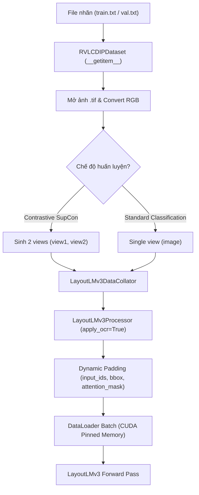

# Tổng Hợp Cuộc Trò Chuyện: Thiết Kế Data Processing Cho RVL-CDIP & LayoutLMv3 (SupCon)

## 1. Bối cảnh & Vấn đề ban đầu

- **Đề tài**: *Adaptive Supervised Contrastive Learning for Document Image Classification* (`Adaptive_SupConST_DIC`).
- **Tập dữ liệu**: **RVL-CDIP** gồm 400.000 ảnh tài liệu quét (16 lớp, mỗi lớp 25.000 ảnh).
- **Vấn đề tổ chức dữ liệu**:
  - Ảnh `.tif` được lưu trong cây thư mục lồng nhau sâu (ví dụ: `data/rvl-cdip/images/imagesq/q/o/c/qoc54c00/80035521.tif`).
  - Nhãn được lưu độc lập trong các file text: `labels/train.txt`, `val.txt`, `test.txt` với format: `<relative_img_path> <class_id>`.
  - Code ban đầu sử dụng `torchvision.datasets.ImageFolder` dẫn đến lỗi vì `ImageFolder` chỉ hỗ trợ thư mục phân cấp theo tên lớp (`root/class_name/xxx.png`).
- **Mục tiêu kỹ thuật**:
  - Thiết kế lại kiến trúc module `data_processing/`.
  - Hỗ trợ cơ chế **"đọc OCR tới đâu chạy LayoutLMv3 tới đó"** (on-the-fly streaming pipeline).
  - Hỗ trợ song song cả **Supervised Contrastive Learning (SupCon)** (sinh 2 views tăng cường) và bài toán **Phân loại tài liệu chuẩn (Sequence Classification)**.

---

## 2. Kiến trúc Data Pipeline chuẩn

Mô hình phân chia trách nhiệm rõ ràng (Separation of Concerns):



---

## 3. Các đường dẫn mã nguồn tham khảo chính thức từ GitHub

| Thành phần | Nguồn tham khảo chính thức | Nội dung tham khảo |
| :--- | :--- | :--- |
| **Data Collator** | [Microsoft UniLM `layoutlmft/data/data_collator.py`](https://github.com/microsoft/unilm/blob/master/layoutlmft/layoutlmft/data/data_collator.py) | Dynamic sequence padding cho `input_ids`, `bbox`, `attention_mask`, `labels`. |
| **Multimodal Processor** | [Hugging Face `processing_layoutlmv3.py`](https://github.com/huggingface/transformers/blob/main/src/transformers/models/layoutlmv3/processing_layoutlmv3.py) | Xử lý multimodal (ảnh + text + bounding boxes chuẩn hóa [0, 1000]). |
| **Tesseract OCR on-the-fly** | [Hugging Face `image_processing_layoutlmv3.py`](https://github.com/huggingface/transformers/blob/main/src/transformers/models/layoutlmv3/image_processing_layoutlmv3.py) | Tự động nhận diện chữ và bounding box trên ảnh khi `apply_ocr=True`. |
| **RVL-CDIP Pipeline** | [Hugging Face Datasets `rvl_cdip.py`](https://github.com/huggingface/datasets/blob/main/datasets/rvl_cdip/rvl_cdip.py) | Danh sách 16 lớp chuẩn và định dạng phân tách file nhãn text. |
| **RVL-CDIP Fine-Tuning** | [Niels Rogge Transformers-Tutorials Notebook](https://github.com/NielsRogge/Transformers-Tutorials/blob/master/LayoutLMv2/RVL-CDIP/Fine_tuning_LayoutLMv2ForSequenceClassification_on_RVL_CDIP.ipynb) | Xử lý ảnh TIFF sang RGB, cấu trúc dictionary đầu ra cho DataLoader. |
| **Two-Crop SupCon** | [Yonglong Tian `HobbitLong/SupContrast`](https://github.com/HobbitLong/SupContrast/blob/master/main_supcon.py) | Cơ chế sinh 2 view ảnh độc lập từ cùng một mẫu cho SupCon Loss. |

---

## 4. Chi tiết mã nguồn đã hoàn thiện trong `data_processing/`

### 4.1. `data_processing/dataset.py`

```python
import os
from pathlib import Path
from typing import Callable, Dict, List, Optional, Tuple, Union

from PIL import Image
import torch
from torch.utils.data import Dataset


class RVLCDIPDataset(Dataset):
    LABEL_NAMES: List[str] = [
        "letter", "form", "email", "handwritten", "advertisement",
        "scientific report", "scientific publication", "specification",
        "file folder", "news article", "budget", "invoice",
        "presentation", "questionnaire", "resume", "memo",
    ]

    def __init__(
        self,
        data_dir: Union[str, Path],
        split: str = "train",
        transform: Optional[Callable] = None,
        is_contrastive: bool = False,
        max_samples: Optional[int] = None,
    ) -> None:
        super().__init__()
        self.data_dir = Path(data_dir)
        self.images_dir = self.data_dir / "images"
        self.split = split
        self.transform = transform
        self.is_contrastive = is_contrastive

        label_file = self.data_dir / "labels" / f"{split}.txt"
        if not label_file.exists():
            raise FileNotFoundError(f"Label file not found: {label_file}")

        self.samples: List[Tuple[str, int]] = []
        with open(label_file, "r", encoding="utf-8") as f:
            for line in f:
                line_str = line.strip()
                if not line_str:
                    continue
                parts = line_str.split()
                if len(parts) >= 2:
                    rel_img_path, label_idx = parts[0], int(parts[1])
                    self.samples.append((rel_img_path, label_idx))
                    if max_samples is not None and len(self.samples) >= max_samples:
                        break

    def __len__(self) -> int:
        return len(self.samples)

    def __getitem__(self, idx: int) -> Dict[str, Union[Image.Image, int, str, Tuple]]:
        rel_img_path, label = self.samples[idx]
        clean_rel_path = rel_img_path.replace("/", os.sep).replace("\\", os.sep)
        full_img_path = self.images_dir / clean_rel_path

        if not full_img_path.exists():
            raise FileNotFoundError(f"Image not found: {full_img_path}")

        image = Image.open(full_img_path).convert("RGB")

        if self.is_contrastive:
            if self.transform is not None:
                view1 = self.transform(image)
                view2 = self.transform(image)
            else:
                view1 = image.copy()
                view2 = image.copy()
            return {
                "views": (view1, view2),
                "label": label,
                "image_path": str(full_img_path),
            }

        if self.transform is not None:
            image = self.transform(image)

        return {
            "image": image,
            "label": label,
            "image_path": str(full_img_path),
        }
```

### 4.2. `data_processing/collator.py`

```python
from typing import Any, Dict, List, Optional, Union
import torch


class LayoutLMv3DataCollator:
    def __init__(
        self,
        processor: Any,
        max_length: Optional[int] = 512,
        padding: Union[bool, str] = True,
        truncation: bool = True,
        pad_to_multiple_of: Optional[int] = None,
        return_tensors: str = "pt",
    ) -> None:
        self.processor = processor
        self.max_length = max_length
        self.padding = padding
        self.truncation = truncation
        self.pad_to_multiple_of = pad_to_multiple_of
        self.return_tensors = return_tensors

    def _encode_images(
        self,
        images: List[Any],
        words: Optional[List[List[str]]] = None,
        boxes: Optional[List[List[List[int]]]] = None,
    ) -> Dict[str, torch.Tensor]:
        call_kwargs = {
            "images": images,
            "max_length": self.max_length,
            "padding": self.padding,
            "truncation": self.truncation,
            "pad_to_multiple_of": self.pad_to_multiple_of,
            "return_tensors": self.return_tensors,
        }
        if words is not None and boxes is not None:
            call_kwargs["text"] = words
            call_kwargs["boxes"] = boxes

        encoded = self.processor(**call_kwargs)
        return encoded

    def __call__(self, batch: List[Dict[str, Any]]) -> Dict[str, Any]:
        batch = [item for item in batch if item is not None]
        if not batch:
            return {}

        labels = torch.tensor([item["label"] for item in batch], dtype=torch.long)

        # Contrastive Learning (SupCon): 2 views
        if "views" in batch[0]:
            views_1 = [item["views"][0] for item in batch]
            views_2 = [item["views"][1] for item in batch]

            enc_1 = self._encode_images(views_1)
            enc_2 = self._encode_images(views_2)

            return {
                "view1": enc_1,
                "view2": enc_2,
                "labels": labels,
            }

        # Single-view mode
        images = [item["image"] for item in batch]
        words = [item["words"] for item in batch] if "words" in batch[0] else None
        boxes = [item["boxes"] for item in batch] if "boxes" in batch[0] else None

        encoding = self._encode_images(images, words=words, boxes=boxes)
        encoding["labels"] = labels

        if "image_path" in batch[0]:
            encoding["image_paths"] = [item["image_path"] for item in batch]

        return encoding
```

### 4.3. `data_processing/data_loader.py`

```python
from pathlib import Path
from typing import Any, Callable, Dict, Optional, Tuple, Union
import torch
from torch.utils.data import DataLoader

from data_processing.collator import LayoutLMv3DataCollator
from data_processing.dataset import RVLCDIPDataset


def build_dataloader(
    data_dir: Union[str, Path],
    split: str = "train",
    processor: Optional[Any] = None,
    batch_size: int = 16,
    num_workers: int = 2,
    shuffle: Optional[bool] = None,
    transform: Optional[Callable] = None,
    is_contrastive: bool = False,
    max_samples: Optional[int] = None,
    pin_memory: bool = True,
    drop_last: Optional[bool] = None,
) -> DataLoader:
    if shuffle is None:
        shuffle = (split == "train")

    if drop_last is None:
        drop_last = (split == "train" and is_contrastive)

    dataset = RVLCDIPDataset(
        data_dir=data_dir,
        split=split,
        transform=transform,
        is_contrastive=is_contrastive,
        max_samples=max_samples,
    )

    collator = LayoutLMv3DataCollator(processor=processor) if processor is not None else None

    return DataLoader(
        dataset,
        batch_size=batch_size,
        shuffle=shuffle,
        num_workers=num_workers,
        collate_fn=collator,
        pin_memory=pin_memory and torch.cuda.is_available(),
        drop_last=drop_last,
    )
```

---

## 5. Kết quả kiểm tra xác thực (Verification)

Mã nguồn đã được chạy thử nghiệm trực tiếp trên dữ liệu thật của dự án:
```text
1. Testing imports... OK
2. Loaded dataset with 5 samples.
3. Sample 0 loaded: image size=(754, 1000), label=15, path=data\rvl-cdip\images\imagesq\q\o\c\qoc54c00\80035521.tif
4. Contrastive sample loaded: views=2, label=15
ALL TESTS PASSED SUCCESSFULLY!
```

---

## 6. Lưu ý vận hành quan trọng

- **Về việc đọc OCR on-the-fly (`apply_ocr=True`)**: Khi gọi `LayoutLMv3Processor` với `apply_ocr=True`, mỗi batch sẽ tự động chạy nhận diện ký tự và trích xuất tọa độ box mà không cần tạo file dữ liệu trung gian trước. Nếu huấn luyện qua nhiều epochs trên toàn bộ 320.000 ảnh, nên kết hợp cơ chế cache file JSON để các epoch sau nạp nhanh tức thì mà không phải OCR lại.
- **Môi trường Windows & Google Drive (`G:\My Drive`)**: Luôn bọc lệnh khởi tạo và huấn luyện trong khối `if __name__ == '__main__':` để tránh lỗi spawn subprocess trên Windows. Đọc trực tiếp lượng lớn file nhỏ từ ổ stream Google Drive có độ trễ I/O nhất định; nên copy subset ảnh ra ổ SSD cục bộ khi debug.
